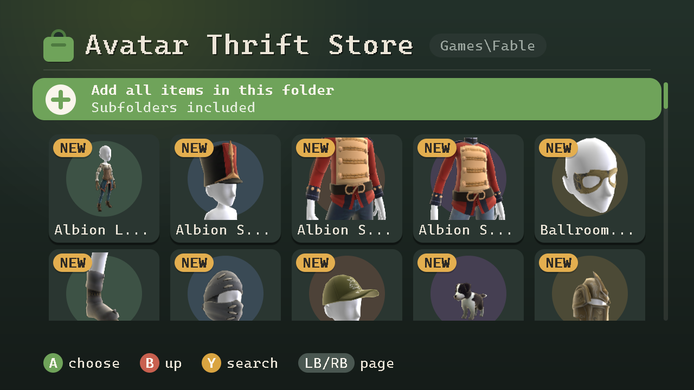

# Avatar Thrift Store

Avatar Thrift Store is a homebrew application for modded Xbox 360 consoles that unlocks avatar item
packages for every profile on the console, including **offline profiles**,
which normally can't wear marketplace items at all. Everything happens on the
console; no PC tools needed. Built with [xsdk](https://github.com/xenosworks/xsdk),
no Microsoft SDK required.



- **Add Items**: browse a folder of item packages (with previews and search)
  and unlock them for every profile on the console.
- **Profiles** *(beta)*: **Activate** lets an offline profile wear unlocked
  items. Signed on the console with its own key, with a backup first.
- **Avatar Editor** *(beta)*: jumps straight to the dashboard's avatar editor.
- **360sona** *(beta)*: save a profile's avatar as a sona code and open it on
  [360sona.com](https://360sona.com), or put an avatar made there on a profile,
  with the items it wears unlocked on the way. See [360sona](#360sona).

Runs on jailbroken consoles (RGH/JTAG; softmodded consoles are untested). No
avatar items are included; bring your own (easy to find online).

## Getting started

1. Download the zip from [Releases](../../releases) and copy the
   `AvatarThriftStore` folder to the hard drive (e.g. `Hdd1:\`) or a USB
   stick. With both, you pick in the item dialog where unlocked items go.
2. Put avatar item packages into `AvatarThriftStore\AvatarItems` (subfolders
   are fine, e.g. one per pack).
3. Start `AvatarThriftStore.xex` from Aurora or FSD.
4. Offline profiles: Sign the profile out, then activate it under
   **Profiles** (pick it, then *Activate for items*). Xbox Live profiles need nothing. Profiles on
   the hard drive and on USB sticks are listed.
5. **Add Items**, pick items (or *Add all items*), then **Avatar Editor** to
   put them on.

Controls: D-pad/left stick, A choose, B back, Y search, LB/RB page, BACK quit.
Pull both triggers for a screenshot (PNG in `AvatarThriftStore\Screenshots`).
Items only show for an avatar of their gender.

## 360sona

[360sona](https://360sona.com) is a web avatar editor that renders Xbox 360
avatars the way the console does, with marketplace items, avatar awards and
the built-in items to dress them in. It saves and opens the same
avatar description the console keeps in each profile, so an avatar can go
back and forth between the two without losing anything: body, face, colours
and every worn item.

They meet in a **sona code**: the avatar as a few lines of text.

```
360sona avatar v1
# Paste this whole thing into 360sona -> My Sonas -> Import.
AAAAAD9MzM0/a4UfABAAAAMcAAMA...
```

Sona codes live in `AvatarThriftStore\Sonas` as `.txt` (or `.sona`) files.

- **Console to 360sona**: **Profiles**, pick a profile, *Save avatar to
  Sonas*. Copy `Sonas\<gamertag>.txt` to a PC, then on 360sona open
  *My Sonas*, *Import / Export*, *Open a .txt* (or paste its text) and
  *Choose a slot*. Saving on 360sona needs a free account (a name and a
  password).
- **360sona to console**: on 360sona, *My Sonas*, *Import / Export*, *Save as
  .txt*. Copy the file into `Sonas`, then **Profiles**, pick a profile, *Wear
  a sona from Sonas*. The app shows what the avatar needs before anything changes:
  - built-in items are on every console;
  - marketplace items and awards whose package is in `AvatarItems` are
    unlocked first, exactly like *Add Items* does;
  - items it finds nowhere stay in the avatar as they are and show only if
    the console has them (an award the profile earned, for example).

  The profile is backed up to `Backups`, rewritten and re-signed with this
  console's key, like *Activate*. Sign in and open the **Avatar Editor** to
  see the result. The profile must be signed out, and must have an avatar
  already (make one in the Avatar Editor once).

The format is plain enough to use elsewhere: `core/sona.h` reads and writes
it, and `avtool` has `sona-export`, `sona-info` and `sona-import`.

## Key findings

Some of the features of this app came from having AI reverse engineer outdated windows executables
the community used in the past. These programms have, for the most part, no publicly available source code.
The key findings are documented here for use in 
future projects.

### Avatar items

- An avatar item is a `LIVE` package. The avatar editor only shows items whose
  license names the profile's **online XUID**, so offline profiles, which have
  none, never see them.
- Unlocking an item means: title id `AAAAAAAA` at `0x360` and in the last 4
  bytes of the asset id (`0x3ED`), the XUID as licensee of license entry 1
  (entries: 16 x licensee/bits/flags at `0x22C`), and the header SHA-1 at
  `0x32C` recomputed. It goes to
  `Content\0000000000000000\AAAAAAAA\00009000\<asset id>`.
- The console accepts XUIDs in the other license entries (2-15) too, so **one
  installed item can be unlocked for several profiles**.
- The package's Microsoft signature no longer matches, which only modded
  kernels tolerate.

### Offline profiles

- An online XUID alone doesn't make items show: the profile also needs the
  Live flag. The Live flag alone makes the console reject the profile.
- What works is this set of values in the profile's `Account` file (0x194
  bytes, HMAC-SHA1/RC4-encrypted with the retail key):

  | Offset | Field | Value |
  |---|---|---|
  | `0x00` | reserved flags | `0x20000001` (Live-enabled) |
  | `0x28` | online XUID | `00090000AAAAAAAA` |
  | `0x34` | service id | `PROD` |
  | `0x3C` | online domain | `xbox.com` |
  | `0x50` | Kerberos realm | `PASSPORT.NET` |
  | `0x68` | key material | `0x81`, then zeros (all zeros: rejected) |

- The online XUID needn't be a real account's: every activated profile can
  share `00090000AAAAAAAA`, and items unlocked once work for all of them.

### Profile signatures

- Profiles are `CON` packages. The signature covers a SHA-1 of header bytes
  `0x22C-0x344` (license entries, header hash, header size); because the
  header hash covers everything below it, that hash stands for the whole
  profile. RSA-1024, PKCS#1 v1.5.
- The header holds 0x228 bytes at `0x004`: the signing console's certificate
  (0x1A8 bytes, with its public key) and the signature (0x80 bytes,
  byte-reversed).
- The console checks that Microsoft signed the certificate and that the
  signature matches it, not which console signed: profiles may move between
  consoles. Any genuine console key is accepted, the console's own included.
- The kernel signs with the console's own key on request:
  `XeKeysConsolePrivateKeySign` (xboxkrnl ordinal `0x256`) takes the 20-byte
  hash and returns the certificate and signature; the private key stays
  inside.

### The avatar

- A profile's avatar is setting `0x63E80044` (Avatar Information) in its
  dashboard GPD, the file `FFFE07D1.gpd` inside the profile. It is a binary
  setting of exactly 1000 bytes: the avatar description, big-endian, version
  0 in its first 4 bytes.
- Its 28 item GUIDs (head shape, face, body, worn items and a cache of the
  required slots) are in the same byte order as an item package's asset id
  at `0x3E1`. Their last 4 bytes are the item's title id, so an item
  unlocked to `AAAAAAAA` has a new id, and the avatar has to name that one.
- Built-in items all end in `C1C8F109A19CB2E0` and need nothing installed.
- A binary setting record is the setting id (u32), 4 bytes, the type (u8,
  `5` = binary), 7 bytes, the length (u32) at `0x10` and the data at `0x18`.
  The avatar always has the same length, so it is replaced in place: the GPD,
  and therefore the profile's file layout, don't change. Only the GPD's
  blocks are rehashed, then the header hash, then the console signature.
- Bytes `901-908` of the description hold the XUID of the profile it was
  saved for; a worn sona keeps the profile's own.

### The avatar editor

- The dashboard's avatar editor opens through `XamLaunchAvatarEditor` (xam
  ordinal `0x7DB`), not a separate program.
- It takes three arguments, `(userIndex, 0, 0)`; with only the user index it
  crashes. The system then closes the calling app and opens the editor for
  that user.

## Building

**Console app** (WSL Debian with xsdk in `~/src/xsdk` and its toolchain in
`~/xsdk-gcc`, plus CMake, Ninja and Python 3):

```powershell
.\build_xbox.ps1                              # -> build\xbox\AvatarThriftStore.xex
.\tools\package_release.ps1 -Version 0.2.0    # -> dist\AvatarThriftStore-v0.2.0.zip
```

The title id is `41565453` ("AVTS"), so Aurora keeps the app's cover and
settings apart from other xsdk titles. The app writes a log next to itself
(`AvatarThriftStore.log`).

**PC tools** (Visual Studio with C++; uses its bundled CMake):

```powershell
.\build_pc.ps1    # avtool + unit tests
```

`avtool` does the same steps on a PC (`info`, `patch`, `set-xuid`,
`sona-export`, `sona-import`,
`verify-sig`, ...); `set-xuid` doesn't sign, so resign its output with another
tool.

## License

MIT, see [LICENSE](LICENSE). Third-party code and the font:
[THIRD_PARTY_NOTICES.md](THIRD_PARTY_NOTICES.md). No avatar items or other
Microsoft content are included.
