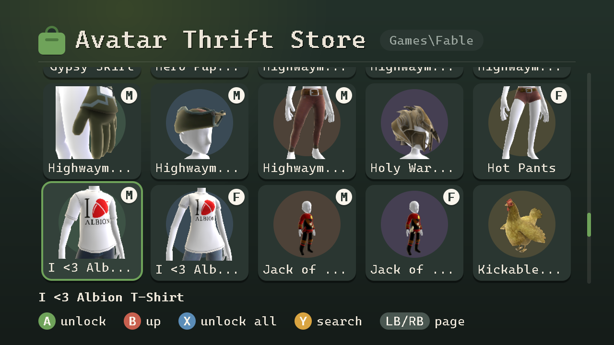

# Avatar Thrift Store

Avatar Thrift Store is a homebrew application for modded Xbox 360 consoles that unlocks avatar item
packages for every profile on the console, including **offline profiles**,
which normally can't wear marketplace items at all. Everything happens on the
console; no PC tools needed. Built with [xsdk](https://github.com/xenosworks/xsdk),
no Microsoft SDK required.



- **Unlock Items**: browse a folder of item packages (with previews and search)
  and unlock them for every profile on the console.
- **Activate Offline Profile**: lets an offline profile wear unlocked
  items. Signed on the console with its own key, with a backup first.
- **Avatar Editor**: jumps straight to the dashboard's avatar editor.

Runs on jailbroken consoles. No
avatar items are included; bring your own (easy to find online).

**Quick disclaimer: I am using this with an activated offline profile (with Xbox Live being blocked, liveblock enabled). I suggest you do the same. Log onto Xbox Live at your own risk!**

## Getting started

1. Download the zip from [Releases](../../releases) and copy the
   `AvatarThriftStore` folder to the hard drive (e.g. `Hdd1:\`) or a USB
   stick. With both, you pick in the unlock dialog where unlocked items go.
2. Put avatar item packages into `AvatarThriftStore\AvatarItems` (subfolders
   are fine, e.g. one per pack).
3. Start `AvatarThriftStore.xex` from Aurora or FSD.
4. Offline profiles: Sign the profile out, then activate it under
   **Activate Offline Profile**. Xbox Live profiles need nothing. Profiles on
   the hard drive and on USB sticks are listed. If an offline profile is still
   signed in when you open **Unlock Items**, the app offers to sign it out and
   activate it for you.
5. **Unlock Items**: unlock single items (or all of them with X), then **Avatar Editor** to
   put them on.

Controls: D-pad/left stick, A open/unlock, X unlock all items in the folder, B back, Y search,
LB/RB page, BACK quit.
Pull both triggers for a screenshot (PNG in `AvatarThriftStore\Screenshots`).
In the avatar editor, items only show for an avatar of their gender. The app lists them all,
with an **M** or **F** badge on each tile (an item's male version comes first).

## How it works (for those interested)

- **One shared XUID for offline profiles.** Activating an offline profile
  gives it the online XUID **`00090000AAAAAAAA`**. Every activated profile
  gets the same one, so to the avatar editor they all look like the same
  owner. Xbox Live profiles keep their own online XUID.
- **One folder for unlocked items.** Unlocking patches a copy of the item
  and licenses it to the shared XUID and to the XUID of every
  Xbox Live profile found on the console. The copy goes to the shared content folder (which every profile can read):

  ```
  Content\0000000000000000\AAAAAAAA\00009000\<asset id>
          shared profile   title id content type (avatar item)
  ```

  On the hard drive that is
  `Hdd1:\Content\0000000000000000\AAAAAAAA\00009000\` (kernel path
  `\Device\Harddisk0\Partition1\Content\...`); on a USB stick it is
  `Usb0:\Content\0000000000000000\AAAAAAAA\00009000\` (`\Device\Mass0\...`).
  The file is named after the item's asset id (16 bytes, as 32 hex digits),
  whose last 4 bytes the patch sets to the title id, so every name ends in
  `AAAAAAAA`. The original file name isn't kept.

So an item unlocked once works for every activated offline profile at once,
and for each Xbox Live profile the app knew about when it was unlocked. For
an Xbox Live profile added later, the item shows as not unlocked again;
unlocking it once more adds that profile (keep the item files for this).

## Code layout

```
core/          the file formats, plain C++ that runs on the PC and the console
app/           the console app (xsdk)
tools/         avtool, a PC command-line tool, and generator scripts
tests/         unit tests for core/, run on the PC
third_party/   stb_image (PNG reading and writing) and xsdk (a submodule)
```

- **`core/`** never opens a file or calls the console. It is handed a
  package's contents as a buffer and changes them there; reading and writing
  the files is up to the app and avtool. Numbers are read and written one
  byte at a time in the console's big-endian order, so the results are the
  same on a PC (x86) and on the console (PowerPC).
  - `stfs`: the package header (`LIVE` items, `CON` profiles), with title id,
    license entries and header hash; `stfs_package`: the files inside a
    package, replaced in place and rehashed.
  - `avatar_item`: unlocking an item (title id, licensees, rehash).
  - `account`, `profile`: a profile's encrypted `Account` file and the
    profile package (shared XUID, console signature); `gpd`: the profile's
    settings and award databases.
  - `sha1`, `rsa`: hashing, and checking signatures (signing is left to the
    console's own key).
- **`app/`** is the console app.
  - `main.cpp`: the app itself, one `App` class with the screens (menu,
    items, search, profiles), dialogs, input and drawing.
  - `items`: scanning `AvatarItems`, previews, what is unlocked where, and
    unlocking; `profiles`: finding and activating profiles; `storage`: files
    and drives (hard drive, USB sticks).
  - `gfx`: a CPU-drawn canvas and its copy to the screen; `screenshot`: PNGs.
  - `imports.txt`, `kernel_extra.h`: the kernel and XAM functions the app
    calls beyond xsdk (console signing, the avatar editor).
  - `font.h` and `menu_art.h` are generated (by `tools/gen_font.ps1` and
    `tools/gen_menu_art.ps1`); don't edit them by hand.
- **`tools/avtool`** runs the `core/` steps on files on a PC, for testing on
  copies without a console; **`tests/`** covers `core/`.

Unlocking an item, end to end: `main.cpp` takes the button press,
`items.cpp` reads the package through `storage.cpp`,
`core/avatar_item.cpp` patches it, `core/stfs.cpp` rehashes it, and
`storage.cpp` writes it to the final `Content` folder.

## Key findings

Some of the features of this app came from having AI reverse engineer outdated windows executables
the community used in the past. These programs have, for the most part, no publicly available source code.
The key findings are documented here for use in future projects.

### Avatar items

- An avatar item is a `LIVE` package. The avatar editor only shows items whose
  license names the profile's **online XUID**, so offline profiles, which have
  none, never see them.
- Unlocking an item means: title id `AAAAAAAA` at `0x360` and in the last 4
  bytes of the asset id (`0x3ED`), the XUID as licensee of license entry 1
  (entries: 16 x licensee/bits/flags at `0x22C`), and the header SHA-1 at
  `0x32C` recomputed. It goes to
  `Content\0000000000000000\AAAAAAAA\00009000\<asset id>`.
- The console accepts XUIDs in the other license entries (2-15) too, so **one
  installed item can be unlocked for several profiles**.
- The package's Microsoft signature no longer matches, which only modded
  kernels tolerate.

### Offline profiles

- An online XUID alone doesn't make items show: the profile also needs the
  Live flag. The Live flag alone makes the console reject the profile.
- What works is this set of values in the profile's `Account` file (0x194
  bytes, HMAC-SHA1/RC4-encrypted with the retail key):

  | Offset | Field | Value |
  |---|---|---|
  | `0x00` | reserved flags | `0x20000001` (Live-enabled) |
  | `0x28` | online XUID | `00090000AAAAAAAA` |
  | `0x34` | service id | `PROD` |
  | `0x3C` | online domain | `xbox.com` |
  | `0x50` | Kerberos realm | `PASSPORT.NET` |
  | `0x68` | key material | `0x81`, then zeros (all zeros: rejected) |

- The online XUID needn't be a real account's: every activated profile can
  share `00090000AAAAAAAA`, and items unlocked once work for all of them.

### Profile signatures

- Profiles are `CON` packages. The signature covers a SHA-1 of header bytes
  `0x22C-0x344` (license entries, header hash, header size); because the
  header hash covers everything below it, that hash stands for the whole
  profile. RSA-1024, PKCS#1 v1.5.
- The header holds 0x228 bytes at `0x004`: the signing console's certificate
  (0x1A8 bytes, with its public key) and the signature (0x80 bytes,
  byte-reversed).
- The console checks that Microsoft signed the certificate and that the
  signature matches it, not which console signed: profiles may move between
  consoles. Any genuine console key is accepted, the console's own included.
- The kernel signs with the console's own key on request:
  `XeKeysConsolePrivateKeySign` (xboxkrnl ordinal `0x256`) takes the 20-byte
  hash and returns the certificate and signature; the private key stays
  inside.

### The avatar editor

- The dashboard's avatar editor opens through `XamLaunchAvatarEditor` (xam
  ordinal `0x7DB`), not a separate program.
- It takes three arguments, `(userIndex, 0, 0)`; with only the user index it
  crashes. The system then closes the calling app and opens the editor for
  that user.

## Building

**Console app** (Linux, or WSL Debian on Windows, with CMake, Ninja and
Python 3). xsdk is a git submodule in `third_party/xsdk`, at the version the
app is built with; its toolchain is built once, into `~/xsdk-gcc`:

On Windows:

```powershell
git submodule update --init                   # after cloning (or clone with --recursive)
wsl -d Debian bash third_party/xsdk/tools/toolchain/build.sh   # once; takes a while
.\build_xbox.ps1                              # -> build\xbox\AvatarThriftStore.xex
.\tools\package_release.ps1 -Version 0.4.1    # -> dist\AvatarThriftStore-v0.4.1.zip
```

On Linux:

```bash
git submodule update --init                      # after cloning (or clone with --recursive)
bash third_party/xsdk/tools/toolchain/build.sh   # once; takes a while
./build_xbox.sh                                  # -> build/xbox/AvatarThriftStore.xex
```

The title id is `41565453` ("AVTS"), so Aurora keeps the app's cover and
settings apart from other xsdk titles. The app writes a log next to itself
(`AvatarThriftStore.log`).

**Desktop tools** (avtool and the unit tests):

- [CMake](https://cmake.org/) 3.20 or newer, on your PATH
- A C++11 compiler: on Windows, Visual Studio with the "Desktop development
  with C++" workload is recommended; on Linux, GCC or Clang

On Windows:

```powershell
.\build_pc.ps1    # avtool + unit tests
```

On Linux:

```bash
./build_pc.sh     # -> build/linux
```

`avtool` does the same steps on a PC (`info`, `patch`, `set-xuid`,
`verify-sig`, ...); `set-xuid` doesn't sign, so resign its output with another
tool.

## License

MIT, see [LICENSE](LICENSE). Third-party code and the font:
[THIRD_PARTY_NOTICES.md](THIRD_PARTY_NOTICES.md). No avatar items or other
Microsoft content are included.
